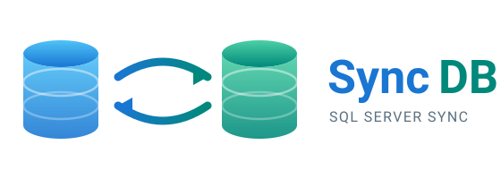

<p align="center">
  
</p>

# SyncDB

**SQL Server to SQL Server data transfer and synchronization — without Linked Servers.**

SyncDB moves data between SQL Server databases on a schedule. It was built for
the common real-world case where two databases sit on different servers, in
different branches, with no network trust and no Linked Server between them.

Runs as a desktop application or as a Windows service.

> This repository distributes the **compiled application only**. The source code
> is not public. See [License](#license).

---

## Download

**[⬇ SyncDB-v41.1.1.zip](../../raw/main/SyncDB-v41.1.1.zip)** — 761 KB

Extract the archive and run `SyncDB.exe`. Keep every file in the same folder:
the DLLs must sit next to the executable.

---

## Why it exists

Multi-branch businesses — retail chains, warehouses feeding a head office,
clinics across several sites — need each branch's data consolidated into one
central database. The usual answers all have problems:

| Approach | Problem |
|---|---|
| Linked Server | Needs network trust and DBA privileges on both servers |
| Replication | Heavy to set up, fragile over unreliable links |
| Manual backup / restore | Not incremental, not scheduled, error-prone |
| A script per site | Unmaintained once its author moves on |

SyncDB reads the source table itself and bulk-writes it to the destination. No
Linked Server required. If the destination table does not exist, it is created
from the source structure.

---

## Features

**Connections** — several named SQL Server connections (server, port, database,
user, password), managed once and reused across jobs.

**Job steps** — a job is a sequence of steps, each of which can be:

- **Transfer** — source table to destination table, in `Append`,
  `TruncateInsert`, or `DeleteInsert` mode
- **T-SQL** — arbitrary T-SQL against source or destination (`GO` supported)
- **Web API to destination** — read JSON from an HTTP(S) endpoint (GET/POST,
  Bearer / Basic / API-key auth, paging) and write it to a destination table

**Linked-Server conversion** — an existing T-SQL step written against a Linked
Server is detected and executed as a native transfer instead, so old scripts
keep working without one.

**Delta sync** — incremental transfer instead of full reload.

**Outbox with replay** — when the destination is unreachable, work is queued
locally and replayed once the link returns. This is what makes it usable over an
unreliable branch connection.

**Scheduling** — per job, by minute / hour / day / week.

**Logging** — per-day log views, retention configurable from 1 to 1095 days.

**Live status and history** — run history plus a live view of work in progress.

**Export / import** — job configurations move between machines. API passwords
and tokens are stripped on export, so configuration files can be shared safely.

---

## Requirements

- Windows
- .NET Framework 4.0 or later
- SQL Server (source and destination)

## Install

1. Download the contents of [`bin/`](bin) — keep all files together in one
   folder; the DLLs must sit next to `SyncDB.exe`.
2. Run `SyncDB.exe`.

To install as a Windows service, run from an **administrator** command prompt:

```bat
install_service.bat
```

To remove it:

```bat
uninstall_service.bat
```

## First run

The application is protected by a login password. The default is:

```
1234
```

**Change it after your first login.** This is a shipped default — it is the same
for every download, so anyone who has this software knows it.

## Where your data is stored

Connections, jobs, and queued work are stored under your user profile:

```
%APPDATA%\SyncDB\
```

Nothing is written next to the executable, and no credentials ship with this
download.

---

## License

This software is **not** open source. See [LICENSE](LICENSE) — all rights
reserved.

You may download and evaluate the application. Commercial use, deployment in a
business environment, redistribution, and reverse engineering are not permitted
without written permission.

For a commercial license, deployment in a business, or a support contract:

- Telegram channel: [@sajadsalemisql](https://t.me/sajadsalemisql)
- Telegram: [@sqlserver2021](https://t.me/sqlserver2021)

Third-party components are listed in
[THIRD-PARTY-NOTICES.md](THIRD-PARTY-NOTICES.md).

---

<div dir="rtl">

## درباره‌ی SyncDB

SyncDB یک برنامه‌ی ویندوزی برای **انتقال و همگام‌سازی داده بین دو SQL Server** است، بدون نیاز به Linked Server.

برای مسئله‌ی واقعی و رایجی ساخته شده: کسب‌وکارهای چندشعبه‌ای — فروشگاه‌های زنجیره‌ای، انبارهایی که به دفتر مرکزی داده می‌دهند، مطب‌ها و مراکز درمانی چندمکانی — که باید داده‌ی هر شعبه در یک دیتابیس مرکزی تجمیع شود، در حالی که دو سرور در دو شبکه‌ی جدا هستند و Linked Server بینشان وجود ندارد.

**در این مخزن فقط برنامه‌ی کامپایل‌شده منتشر شده است؛ کد منبع عمومی نیست.**

### امکانات

- **اتصال‌های چندگانه** — چند اتصال نام‌دار SQL Server که در همه‌ی jobها قابل استفاده است
- **انتقال مستقیم جدول** — در سه حالت `Append`، `TruncateInsert` و `DeleteInsert`؛ اگر جدول مقصد نباشد از ساختار مبدأ ساخته می‌شود
- **اجرای T-SQL** روی مبدأ یا مقصد، با پشتیبانی از `GO`
- **دریافت از Web API** — خواندن JSON از یک سرویس HTTP و نوشتن در جدول مقصد
- **تبدیل خودکار Linked Server** — اسکریپت‌های موجود شناسایی و به انتقال بومی تبدیل می‌شوند
- **همگام‌سازی تفاضلی (Delta)** — انتقال افزایشی به جای بارگذاری کامل
- **صف Outbox با بازپخش** — وقتی مقصد در دسترس نیست کار محلی صف می‌شود و با بازگشت ارتباط ارسال می‌شود
- **زمان‌بندی** — دقیقه‌ای، ساعتی، روزانه، هفتگی
- **لاگ‌گیری** با نگهداری قابل تنظیم از ۱ تا ۱۰۹۵ روز
- **اجرا به صورت سرویس ویندوز** یا برنامه‌ی دسکتاپ

### پیش‌نیازها

ویندوز، .NET Framework 4.0 یا بالاتر، و SQL Server در مبدأ و مقصد.

### دانلود

**[⬇ SyncDB-v41.1.1.zip](../../raw/main/SyncDB-v41.1.1.zip)** — ۷۶۱ کیلوبایت

فایل را استخراج کنید و `SyncDB.exe` را اجرا کنید. همه‌ی فایل‌ها باید در یک پوشه کنار هم بمانند.

### نصب

محتویات پوشه‌ی `bin` را دانلود کنید و همه‌ی فایل‌ها را **در یک پوشه کنار هم** نگه دارید — فایل‌های DLL باید کنار `SyncDB.exe` باشند. سپس `SyncDB.exe` را اجرا کنید.

برای نصب به صورت سرویس ویندوز، `install_service.bat` را با دسترسی **Administrator** اجرا کنید.

### اولین اجرا

ورود به برنامه با رمز عبور محافظت می‌شود. رمز پیش‌فرض:

```
1234
```

**بعد از اولین ورود حتماً عوضش کنید.** این رمز پیش‌فرضِ نسخه‌ی منتشرشده است و برای همه‌ی دانلودها یکسان؛ یعنی هر کسی که این نرم‌افزار را دارد آن را می‌داند.

### محل ذخیره‌ی اطلاعات

اتصال‌ها، jobها و صف کارها زیر `%APPDATA%\SyncDB\` ذخیره می‌شوند. هیچ چیزی کنار فایل اجرایی نوشته نمی‌شود و هیچ اطلاعات اتصالی همراه این دانلود نیست.

### مجوز

این نرم‌افزار **متن‌باز نیست** و تمام حقوق محفوظ است. دانلود و ارزیابی آزاد است؛ استفاده‌ی تجاری، راه‌اندازی در محیط کاری، بازتوزیع و مهندسی معکوس بدون اجازه‌ی کتبی مجاز نیست.

برای لایسنس تجاری، راه‌اندازی در محیط کاری یا قرارداد پشتیبانی:

- کانال تلگرام: [@sajadsalemisql](https://t.me/sajadsalemisql)
- تلگرام: [@sqlserver2021](https://t.me/sqlserver2021)

</div>
